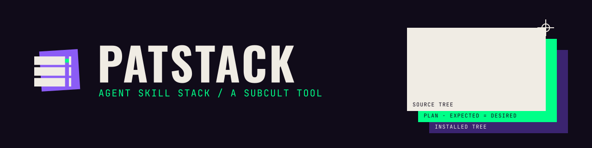

# patstack



patstack is the owner's agent skill stack: the personal skills, shared skills,
optional library, profiles, global agent instructions and the guarded tooling
that deploys them to every host. It was called `codex-skills` until 2026-11-03,
and Gitea redirects the old URL. It is separate from Blacktower's package catalog.

The source of truth is [git.subcult.tv/subculture-collective/patstack](https://git.subcult.tv/subculture-collective/patstack).
Gitea pushes it to the private GitHub mirror
[subculture-collective/patstack](https://github.com/subculture-collective/patstack)
on every commit and every 8 hours; open PRs on Gitea, not on GitHub.

It holds 52 curated personal skills (54 personal entrypoints with Omarchy's two
OS-owned ones), 6 shared skills, one repository-local Blacktower skill, vault
and project skills, and a 326-skill optional library. Names follow a distinct
noun plus purpose (`bug-tracer`, `prose-unslop`, `relay-baton`);
`catalog/retired-names.json` maps every old name to its owner.

## Brand

patstack has a selected identity: the **A1 Rack system with A3 Registration's plates**, chosen on November 3, 2026 from nine candidates. Rack units stand for the fleet, registered plates for the verify guarantee, and the status labels `[ACTIVE]`, `[WARNING]`, `[VETO]` and `[ARCHIVE]` always agree with the installer's real result. The masters live in SUBCULT Studio; [brand/GUIDE.md](brand/GUIDE.md) explains the rules and `brand/studio-assets.json` records where each copied file came from.

## Layout and ownership

- `skills/`: authored personal skills, installed as managed copies in `~/.codex/skills`.
- `shared/`: the six shared skills (`scope-grill`, `relay-baton`, `voice-ledger`, `content-recaster`, `launch-dossier`, `skill-stack-router`), installed in `~/.agents/skills`. Duplicate Codex copies are retired.
- `repository-skills/blacktower-development`: installed only in Blacktower’s `.agents/skills`, privately excluded through Git’s local exclude file.
- `library/skills/`: the optional reservoir. `profiles/*.txt` group it into the Subsets categories described below.
- `vault-agents/`: root `AGENTS.md` files and local skills for the four vaults, deployed by `scripts/vault-agents.py` (`catalog/vault-agents.json` maps each file, including the library copies of vault skills).
- `project-agents/`: project skills and instruction blocks, deployed by `scripts/project-skills.py` (`catalog/project-selections.json`).
- `instructions/`: the shared working rules (`WORKING.md`), per-host facts (`hosts.json`), Gitea identity and RTK guidance that `scripts/global-instructions.py` renders into every client's global file.
- `runtime-bundles/subsets-fleet/`: the Subsets adapter bundle built and deployed per host.
- `authoring/`: non-discovered guidance for maintaining the collection.
- `catalog/proposed-catalog.json`: authoritative target; `capabilities.json` maps 138 imported capabilities and the authored T3 onboarding capability to owners and procedures. `retired-names.json` maps retired names, with no compatibility entrypoints.
- `catalog/baseline.json`: pre-migration hashes, modes, and symlinks. `installation.json` records this host’s destinations and immutable archive location.
- `evaluations/`, `tests/`, `reports/`: bounded behavior trials, deterministic tests, discovery measurements, and rollout evidence.

`omarchy` and `diagnose-crash` remain OS-owned symlinks. Their links and `/usr/share/omarchy` targets are protected. The personal `diff-auditor` duplicate is removed; its system owner is unchanged. Managed plugin caches are outside this installer’s authority.

Original trees are recoverable at `/home/onnwee/.codex/skill-backups/20260908T034154Z-before-consolidation`, outside discovered roots. Imported scripts, assets, and notices remain beside their applicable mode. Resource paths in a mode resolve from that mode’s directory. `<skill-root>` in command examples means the resolved directory of the loaded entrypoint, not the current project directory.

## Installation

Requires Python 3 on Linux; validation additionally needs PyYAML. The installer uses only the standard library. Run from this repository after committing reviewed sources:

```sh
python scripts/validate.py
PYTHONDONTWRITEBYTECODE=1 python -m unittest discover -s tests -v
python scripts/install.py plan > /tmp/patstack-plan.json
python scripts/install.py apply --through 1
# Use the run path printed by apply for both following batches:
python scripts/install.py apply --resume <run-path> --through 2
python scripts/install.py apply --resume <run-path> --through 3
python scripts/install.py verify
```

Review `plan` before applying. It is read-only and records source revision, destinations, expected/desired trees, ownership, and retired names. Each tree records SHA-256, executable modes, and symlink targets. `apply` writes a journal and verified original backups under `~/.codex/skill-installations/codex-skills/run-*`. Completed operations gain `backupLocation` and actual original state. The installed manifest is `~/.codex/skill-installations/codex-skills/installed.json`; the state folder keeps the pre-rename name so existing receipts stay valid.

Apply rejects drift from the recorded baseline or last installed snapshot. Preserve intervening edits and review a reconciliation before updating the baseline; never bypass drift by overwriting it blindly. A repeated successful apply is idempotent. An unfinished batch must be resumed or rolled back. Completed paths are reverified when a later batch resumes.

```sh
python scripts/install.py rollback --run <run-path>
```

Rollback restores only that transaction’s changed destinations and the preceding installed manifest. It preflights all affected paths and preserves intervening edits. Interrupted apply and rollback can resume from journaled stages. Backups and originals remain outside discovery. Retain the repository and run directory until rollback is no longer needed.

## Maintenance

Gitea runs source validation and the disposable installer/selection tests on PRs and main. `python scripts/validate.py --source-only` checks the repository without reading installed OS or system skills. Its report lists those owners as unverified; installation verification still requires the normal validator and the destination checks below. CI never installs skills or changes client configuration.

Edit authored sources here; never maintain installed copies as the source of truth. Keep task descriptions concise and put substantial procedures in conditionally loaded references. Preserve plan-only, read-only review, explicit strict review, explicit TypeScript boundary setup, and separate publishing/deployment scope. New capabilities need a concrete trigger, resource links, and an acceptance fixture. General principles belong in relevant conditional references, not new globally discovered entrypoints.

`build_collection.py` is the historical one-time import recipe, not an update command: rerunning it is unsupported after curation. Update the catalog and capability map explicitly when changing ownership. Preserve provenance and licenses when moving resources. The frontend CSV dataset is pinned to MIT-licensed upstream revision `363cd8911f210ec640704101ee820e6e64a63c3b`; its per-file hashes and notices are in `skills/ui-craft/scripts/data/provenance.json` and `notices/`.

Before each release, run validation and focused helper tests, then bounded behavior fixtures. Permit at most one repair-and-retest round per failed behavioral case. Capture fresh `skills/list` in Blacktower and an unrelated repository with `scripts/discovery.py`. Confirm shared owners appear once, retired names are absent, and the Blacktower skill stays local. Source character budgets and runtime metadata measurements are distinct from model token billing; report unavailable token usage explicitly.

Changes land through PRs on Gitea; CI must pass before merge. After a merge, pull the canonical checkout on Kvant (`~/Work/Tools/patstack`) under `umask 022` so installers do not see group-writable modes as drift, then run the relevant deployer. See [the operating model](docs/OPERATING-MODEL.md) and [the September review](reports/2026-09-20-upstream-review.md).

## Subsets TUI and CLI

[Subsets](https://git.subcult.tv/subculture-collective/subsets) owns the standalone skill manager application. It discovers local skills, organizes named groups, and previews/applies selections with recorded ownership and recoverable backups. Its optional adapter edits canonical profiles and calls this repository’s guarded deployment commands.

The application source lives in the sibling `subsets` repository. Original application history remains in commit `88d665b`; the private migration checkpoint preserves the original directory and machine verification report.

```sh
uv tool install --editable ../subsets
subsets
subsets apply --frontend-mobile --dry-run
```

System and plugin directories retain their owners. Existing installer-managed roots use explicit backends. See the [discovery and ownership guidelines](https://git.subcult.tv/subculture-collective/subsets/src/branch/main/docs/discovery-ownership.md) before adopting another folder.

## Subsets: choosing optional skills

Start with [the skills and groups guide](docs/SKILL-GROUPS.md) for every default
skill, all 14 groups, full membership links, and required/optional relationships.
The default `skill-stack-router` loads qualified specialists on demand; ordinary
tasks do not require switching profiles. Companion references also connect
specialists to one another. Switch when you want a different set directly
discoverable for sustained work or need a different client/tool environment.

[Subsets](runtime-bundles/subsets-fleet/README.md) is the app on every host that
switches which optional library skills are active. `core` is always on; add a
category when the work calls for it, and drop back to `core` afterwards so
discovery stays small and routing stays sharp.

### Which category to pick

Counts are the optional library skills each category adds; the 52 curated
skills and the shared skills are always installed and are not listed.

| Category | Pick it when you are | Skills |
|---|---|---|
| `core` | always active: fact checks, summaries and web lookup, plus the six shared skills | 3 |
| `ai-agents` | running or configuring agents: parallel candidates and swarms, Ralph loops, handoffs, mining your own sessions, skill authoring, Blacktower/OpenCode/Codex/Cursor setup | 25 |
| `engineering` | planning, understanding or shipping code: implementation plans, specs, tickets, code walkthroughs, design alternatives, commit recaps | 23 |
| `testing-quality` | reviewing or proving a change: blast radius, branch shipping, double reviews, verification skills, issue triage, test design | 12 |
| `backend-devops` | building services or infrastructure: Stripe, Temporal, Kubernetes, Terraform, web server hardening, fleet operations, backtests | 8 |
| `security` | doing security-sensitive work: PCI scope, memory forensics, binary reverse engineering, Solidity audits, server hardening | 6 |
| `frontend-mobile` | building interfaces: React Native/Expo, terminal UIs, VS Code extensions, userscripts, charts, HUD design, web games | 8 |
| `tooling-homelab` | working with your own tools: Obsidian, Karakeep, Super Productivity, desktop capture, Switchyard, Blacktower, client guardrails | 15 |
| `docs-research` | working with documents or research: DOCX, PDF, spreadsheets, PPTX, ebooks, source research, memos, claim probes | 14 |
| `learning` | teaching or learning: multi-session courses, roadmaps, tutoring, retrospectives, exercise scaffolds | 5 |
| `product-growth` | marketing or selling: positioning, landing pages, SEO, ads, email flows, social posts, sales collateral, launch plans | 21 |
| `creative-media-design` | making media: marketing images, raster art, video, music prompts, slides, game design | 10 |
| `writing-nonfiction` | writing articles or talks: shaping drafts, restructuring, fragments, speech adaptation, voice capture, naming | 11 |
| `writing-worldbuilding` | writing fiction or building worlds: story diagnosis, arcs, dialogue, conlangs, tropes, tabletop play, world bibles | 30 |

Every activatable library skill belongs to at least one category, and some sit
in two where the work overlaps (for example `stripe-checkout-wiring` is in
`backend-devops` and `security`). Combine categories when a task spans them,
for example `--engineering --testing-quality`. The categories also appear in
the Groups view of the `subsets` TUI and work with `subsets apply --group NAME`.

### How to switch

1. Preview: `subsets apply --engineering --dry-run` (or open `subsets` and use the Groups view).
2. Apply: `subsets apply --engineering`. Several flags can be combined.
3. Start a fresh agent session; a running session keeps the skill list it started with.
4. Return to the default: `subsets apply --group core`.
5. Undo a switch: `~/.agents/bin/skill-profile rollback --run PATH`, newest run first, with the run folders under `~/.local/state/subsets-fleet/profiles/`. Rollback refuses files edited after the switch.

### Changing categories for the fleet

Edit `profiles/*.txt` here, commit, then build and roll out a new bundle:
`python runtime-bundles/subsets-fleet/scripts/build-bundle.py`, copy the printed
folder to the same path on each host, and run its
`scripts/deploy-host.py --node NODE --python PYTHON`. The runtime paths each host
uses are in its `~/.local/bin/subsets` launcher. See the
[adapter README](runtime-bundles/subsets-fleet/README.md) for ownership and rollback.

## License

Original contributions in this repository are licensed under the GNU General
Public License, version 3 or (at your option) any later version
(`GPL-3.0-or-later`). See [LICENSE](LICENSE).

Third-party code, documentation, fonts, data, and other assets retain their own
licenses, copyright notices, and attribution. This license does not replace
those terms or grant rights to upstream material that its authors have not granted.
